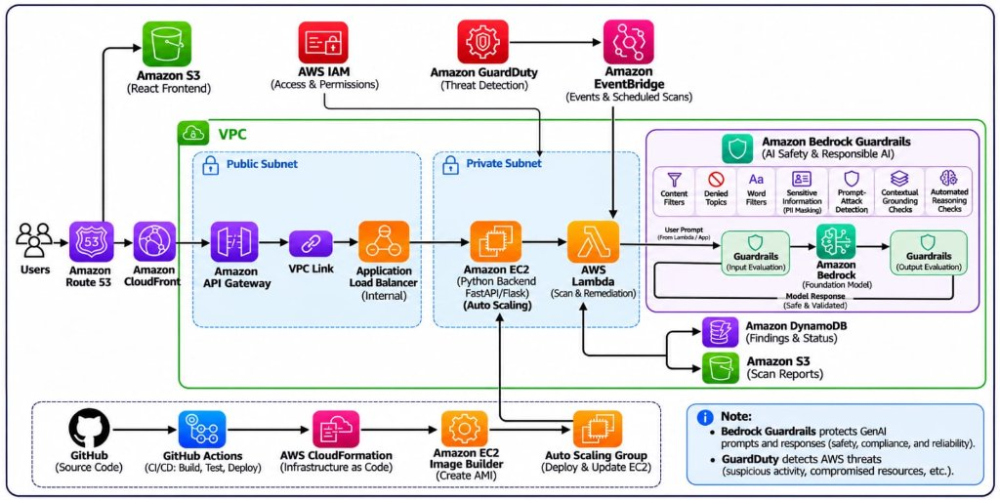

# AWS Cloud Architecture Specification

## AI-Powered AWS Security Monitoring & Expense Tracker Web Application



This document details the enterprise cloud architecture represented in the architecture diagram and implemented via Terraform and CloudFormation infrastructure-as-code templates in this repository.

---

## Architecture Diagram Overview

```
                                      [ Amazon Route 53 (DNS) ]
                                                  │
                                                  ▼
                               [ AWS WAF (Rate Limiting & OWASP Rules) ]
                                                  │
                                                  ▼
                                     [ Amazon CloudFront (CDN) ]
                                     /                         \
                           (Default /*)                   (/api/* & /health)
                                 │                                 │
                                 ▼                                 ▼
                     [ Amazon S3 (Frontend) ]         [ Amazon API Gateway (HTTP API) ]
                       (CloudFront OAC)                            │
                                                                   ▼
                                                        [ API Gateway VPC Link ]
                                                                   │
+-- Amazon VPC (10.0.0.0/16 Multi-AZ) ─────────────────────────────┼──────────────────────────+
│                                                                  ▼                          │
│  +-- Public Subnets ────────────────----+    +-- Private Subnets ────────────────────────+  │
│  │                                      │    │                                           │  │
│  │  [ Internet & NAT Gateway ]          │    │  [ Application Load Balancer ]            │  │
│  │                                      │    │  (Internal ALB on Port 80)                │  │
│  │                                      │    │         │                                 │  │
│  │                                      │    │         ▼                                 │  │
│  │                                      │    │  [ Amazon EC2 Auto Scaling Group ]        │  │
│  │                                      │    │  (FastAPI Backend, Port 8000)             │  │
│  │                                      │    │  - AWS Secrets Manager integration        │  │
│  │                                      │    │  - VPC Gateway Endpoints (S3 & DynamoDB)  │  │
│  │                                      │    │                                           │  │
│  │                                      │    │  [ AWS Lambda Function ] <-------------+  │  │
│  │                                      │    │  (Security Scanner & FinOps)           │  │  │
│  +──────────────────────────────────────+    +────────────────────────────────────────+--+--+
│                                                                │                            │
│  +-- Isolated Database Subnets (Zero Route to Internet) ───────┼─────────────────────────+  │
│  │                                                             ▼                         │  │
│  │  [ Amazon RDS MySQL 8.0 ] (AWS Graviton db.t4g.micro, gp3 Encrypted)                  │  │
│  │  - Port 3306 restricted strictly to EC2 Security Group                                │  │
│  +───────────────────────────────────────────────────────────────────────────────────────+  │
+───────────────────────────────────────────────────────────────────────────────────────+-----+
                                                                                        │
         +──────────────────────────────────────────────────────────────────────────────+
         │                                                                              │
         ▼                                                                              ▼
[ Amazon GuardDuty ] (Threats)                                              [ Amazon EventBridge ]
         │                                                                  (Cron: rate(6 hours))
         +──────────────────────────────────> [ AWS Lambda ] <──────────────────────────+
                                                     │
                 +───────────────────────────────────+───────────────────────────────────+
                 │                                                                       │
                 ▼                                                                       ▼
  [ Amazon Bedrock Guardrails ]                                            [ Amazon DynamoDB & S3 ]
  (Safety & Responsible AI)                                                - DynamoDB: SecurityFindingsTable
  - Content Filters (Hate, Violence, Misconduct)                           - S3: Scan Reports Bucket
  - Sensitive Info (PII Masking: Email, Phone, Cards)
  - Prompt-Attack & Injection Detection
  - Foundation Model (Claude 3 Haiku / Titan)
```

---

## 1. Perimeter, DNS & Edge Delivery
- **Amazon Route 53**: Resolves custom domain names and routes traffic to Amazon CloudFront with latency-based and failover routing.
- **AWS WAFv2**: Protects CloudFront with IP Rate Limiting (500 req/5 min) and AWS Managed Rules (OWASP Top 10 Common Rule Set and Known Bad Inputs).
- **Amazon CloudFront**:
  - Global Content Delivery Network (CDN) with TLS 1.3 encryption.
  - **Behavior 1 (`/*`)**: Serves the React 19 single-page application from an isolated S3 bucket protected by **CloudFront Origin Access Control (OAC)**. Rewrites 403/404 errors to `/index.html` for client-side routing.
  - **Behavior 2 (`/api/*` and `/health`)**: Proxies dynamic backend requests directly to Amazon API Gateway with query string, header, and cookie forwarding (zero cache TTL).

---

## 2. API Gateway & VPC Link Layer
- **Amazon API Gateway (HTTP API v2)**:
  - Low-latency, cost-effective serverless API gateway (70% cheaper than REST API).
  - Validates incoming requests and terminates public traffic.
- **VPC Link**:
  - Securely bridges API Gateway traffic into the private subnets of the VPC without exposing the Internal ALB to the public internet.

---

## 3. High Availability VPC Networking & FinOps
- **Amazon VPC (`10.0.0.0/16`)**:
  - **Public Subnets (2 AZs)**: `10.0.1.0/24`, `10.0.2.0/24` with Internet Gateway and Elastic IP NAT Gateway.
  - **Private Subnets (2 AZs)**: `10.0.11.0/24`, `10.0.12.0/24` with outbound default route through the NAT Gateway.
  - **Isolated Database Subnets (2 AZs)**: `10.0.21.0/24`, `10.0.22.0/24` with zero route to internet or NAT (internal traffic only).
- **VPC Gateway Endpoints (Cost-Optimized)**:
  - Free Gateway Endpoints for **Amazon S3** and **Amazon DynamoDB**, bypassing the NAT Gateway and completely eliminating the $0.045/GB NAT data processing surcharge.
- **Internal Application Load Balancer (ALB)**:
  - Deployed internally across private subnets.
  - Distributes traffic to backend instances on port 8000.
  - Target Group health checks monitor the `/health` endpoint every 30 seconds.

---

## 4. Compute & Auto Scaling Group
- **Amazon EC2 Launch Template**:
  - Amazon Linux 2023 with Python 3.11, systemd daemon management, and FastAPI backend service.
  - Protected with IAM instance profile (`AmazonSSMManagedInstanceCore` + Secrets Manager access) enabling zero-bastion AWS Systems Manager Session Manager access.
  - UserData script pulls production database connection strings dynamically from AWS Secrets Manager.
- **Auto Scaling Group (ASG)**:
  - Min: 1, Max: 3, Desired: 1.
  - Automatically replaces unhealthy instances and scales up under CPU/network thresholds.

---

## 5. Relational Database Tier (Isolated Data Tier)
- **Amazon RDS MySQL 8.0**:
  - Instance class: `db.t4g.micro` powered by **AWS Graviton2** (ARM architecture for 20% cost savings and superior price/performance).
  - Deployed across an isolated `DBSubnetGroup` with zero direct internet access.
  - Security Group chaining restricts port 3306 exclusively to the Backend EC2 Security Group.
  - Encrypted storage with AWS KMS (20 GB gp3 with storage autoscaling).
  - Automated backups with 1-day retention (dev) or 7-day Multi-AZ retention (prod).

---

## 6. Threat Detection & Event Automation
- **Amazon GuardDuty**:
  - Continuous intelligent threat detection monitoring AWS CloudTrail, VPC Flow Logs, and DNS logs.
  - Detects compromised credentials, unauthorized port probes, and crypto-mining activity.
- **Amazon EventBridge**:
  - **Rule 1 (Real-Time Threat Rule)**: Filters for `source: ["aws.guardduty"]` and `detail-type: ["GuardDuty Finding"]`.
  - **Rule 2 (Scheduled Scan Rule)**: Fires automated 6-hour cron triggers (`rate(6 hours)`) to audit expenses, anomalies, and cloud resource configurations.

---

## 7. AI Security Analysis with Amazon Bedrock & Guardrails
- **AWS Lambda (`SecurityScannerFunction`)**:
  - Executes Python 3.11 runtime within private subnet or with VPC endpoint access.
  - Extracts threat attributes (severity, affected EC2 instance, IP address, finding type).
- **Amazon Bedrock Guardrails (`ExpenseTrackerSecurityGuardrail`)**:
  - **Input Evaluation**: Sanitizes input prompts, masks PII (emails, phone numbers, AWS access keys, card numbers), and thwarts prompt injections.
  - **Foundation Model**: Invokes Anthropic Claude 3 Haiku or Amazon Titan to generate actionable root-cause analysis and automated remediation steps.
  - **Output Evaluation**: Filters potential model hallucinations, policy leaks, or sensitive financial data before persisting results.

---

## 8. Storage, Findings & Reports
- **Amazon DynamoDB (`SecurityFindingsTable`)**:
  - Low-latency NoSQL table storing processed security findings, AI analysis, severity ratings, and remediation status.
  - Key schema: Partition Key `finding_id`, Sort Key `timestamp`.
  - Global Secondary Index: `StatusIndex` on `status` and `timestamp`.
- **Amazon S3 (`ScanReportsBucket`)**:
  - Encrypted with AES-256 server-side encryption.
  - Configured with FinOps **Lifecycle Configuration**: transitions to Standard-IA after 30 days and expires after 90 days.
- **Amazon S3 (`FrontendBucket`)**:
  - Dedicated hosting bucket for Vite React build artifacts, secured via CloudFront OAC.

---

## 9. Comprehensive Exam & Viva Guide
For a deep dive into viva questions, 6-pillar Well-Architected Framework reviews, and detailed FinOps pricing formulas, see:
- [CLOUD_INFRASTRUCTURE_EXAM_GUIDE.md](file:///E:/My%20projects/AI-powered-AWS-Security-Monitoring-Expense-Tracker-app/docs/CLOUD_INFRASTRUCTURE_EXAM_GUIDE.md)
