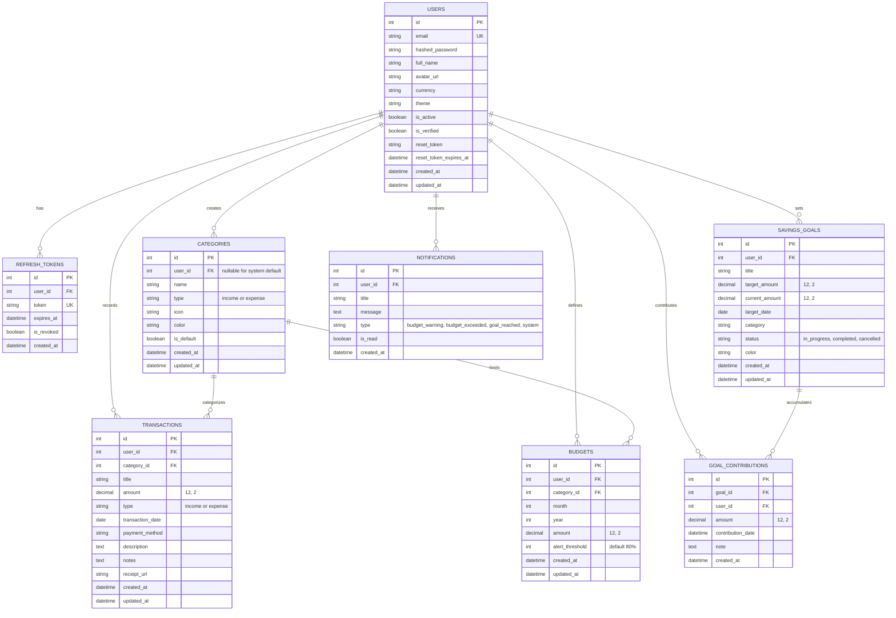

# Database Design Document - Expense Tracker Web Application

## 1. Overview
The database for the Expense Tracker application is built using MySQL 8.0 with SQLAlchemy 2.0 ORM and Alembic migrations. The schema is designed for multi-tenant isolation (each user owns their financial records), strict referential integrity with foreign key constraints, proper decimal precision for monetary amounts, and optimal indexing for high-frequency search and aggregation queries.

---

## 2. Relational Architecture & ER Diagram

---

## 3. Table Specifications

### 3.1. `users`
Stores user authentication details and preferences.
- `id` (INT, PK, AUTO_INCREMENT): Primary identifier.
- `email` (VARCHAR(255), UNIQUE, NOT NULL, INDEXED): Unique email address.
- `hashed_password` (VARCHAR(255), NOT NULL): bcrypt hashed password string.
- `full_name` (VARCHAR(150), NOT NULL): User's display name.
- `avatar_url` (VARCHAR(500), NULL): Profile photo URL.
- `currency` (VARCHAR(10), NOT NULL, DEFAULT 'USD'): Preferred currency (USD, EUR, GBP, INR, JPY, CAD, AUD, etc.).
- `theme` (VARCHAR(20), NOT NULL, DEFAULT 'system'): UI theme ('light', 'dark', 'system').
- `is_active` (BOOLEAN, NOT NULL, DEFAULT TRUE): Account status.
- `is_verified` (BOOLEAN, NOT NULL, DEFAULT TRUE): Email verification status.
- `reset_token` (VARCHAR(255), NULL, INDEXED): Password recovery token.
- `reset_token_expires_at` (DATETIME, NULL): Expiry time for reset token.
- `created_at` (DATETIME, NOT NULL, DEFAULT CURRENT_TIMESTAMP).
- `updated_at` (DATETIME, NOT NULL, DEFAULT CURRENT_TIMESTAMP ON UPDATE CURRENT_TIMESTAMP).

### 3.2. `refresh_tokens`
Enables secure long-lived sessions with token rotation and revocation.
- `id` (INT, PK, AUTO_INCREMENT).
- `user_id` (INT, FK -> users.id, ON DELETE CASCADE, NOT NULL, INDEXED).
- `token` (VARCHAR(512), UNIQUE, NOT NULL, INDEXED): Opaque cryptographic refresh token.
- `expires_at` (DATETIME, NOT NULL, INDEXED).
- `is_revoked` (BOOLEAN, NOT NULL, DEFAULT FALSE).
- `created_at` (DATETIME, NOT NULL, DEFAULT CURRENT_TIMESTAMP).

### 3.3. `categories`
Categorization for income and expense transactions.
- `id` (INT, PK, AUTO_INCREMENT).
- `user_id` (INT, FK -> users.id, ON DELETE CASCADE, NULL, INDEXED): NULL represents global default categories; non-null represents custom categories for that user.
- `name` (VARCHAR(100), NOT NULL, INDEXED).
- `type` (ENUM('income', 'expense'), NOT NULL, INDEXED).
- `icon` (VARCHAR(50), NOT NULL, DEFAULT 'Tag'): Lucide icon identifier.
- `color` (VARCHAR(20), NOT NULL, DEFAULT '#6366f1'): Hex color code for UI badges and charts.
- `is_default` (BOOLEAN, NOT NULL, DEFAULT FALSE): Flag indicating system-seeded defaults.
- `created_at` (DATETIME, NOT NULL, DEFAULT CURRENT_TIMESTAMP).
- `updated_at` (DATETIME, NOT NULL, DEFAULT CURRENT_TIMESTAMP ON UPDATE CURRENT_TIMESTAMP).
- Unique Constraint: `(user_id, name, type)`.

### 3.4. `transactions`
The core ledger of all financial activities.
- `id` (INT, PK, AUTO_INCREMENT).
- `user_id` (INT, FK -> users.id, ON DELETE CASCADE, NOT NULL, INDEXED).
- `category_id` (INT, FK -> categories.id, ON DELETE RESTRICT, NOT NULL, INDEXED).
- `title` (VARCHAR(255), NOT NULL, INDEXED).
- `amount` (DECIMAL(12, 2), NOT NULL): Exact monetary quantity.
- `type` (ENUM('income', 'expense'), NOT NULL, INDEXED).
- `transaction_date` (DATE, NOT NULL, INDEXED): The date the transaction occurred.
- `payment_method` (VARCHAR(50), NOT NULL, DEFAULT 'other'): 'cash', 'credit_card', 'debit_card', 'bank_transfer', 'upi', 'other'.
- `description` (TEXT, NULL): Detailed description.
- `notes` (TEXT, NULL): Additional user notes.
- `receipt_url` (VARCHAR(500), NULL): Optional receipt image or PDF link.
- `created_at` (DATETIME, NOT NULL, DEFAULT CURRENT_TIMESTAMP).
- `updated_at` (DATETIME, NOT NULL, DEFAULT CURRENT_TIMESTAMP ON UPDATE CURRENT_TIMESTAMP).
- Composite Indexes:
  - `(user_id, transaction_date)`: For date-range filtering.
  - `(user_id, type, transaction_date)`: For income vs. expense analytics.
  - `(user_id, category_id)`: For category breakdowns.

### 3.5. `budgets`
Category-specific and total monthly spending thresholds.
- `id` (INT, PK, AUTO_INCREMENT).
- `user_id` (INT, FK -> users.id, ON DELETE CASCADE, NOT NULL, INDEXED).
- `category_id` (INT, FK -> categories.id, ON DELETE CASCADE, NOT NULL, INDEXED).
- `month` (TINYINT UNSIGNED, NOT NULL): 1 - 12.
- `year` (SMALLINT UNSIGNED, NOT NULL): e.g. 2026.
- `amount` (DECIMAL(12, 2), NOT NULL): Budget cap for the month.
- `alert_threshold` (TINYINT UNSIGNED, NOT NULL, DEFAULT 80): Percent threshold to trigger early warning (e.g. 80%).
- `created_at` (DATETIME, NOT NULL, DEFAULT CURRENT_TIMESTAMP).
- `updated_at` (DATETIME, NOT NULL, DEFAULT CURRENT_TIMESTAMP ON UPDATE CURRENT_TIMESTAMP).
- Unique Constraint: `(user_id, category_id, month, year)`.

### 3.6. `savings_goals`
Targets for accumulating savings with progress tracking.
- `id` (INT, PK, AUTO_INCREMENT).
- `user_id` (INT, FK -> users.id, ON DELETE CASCADE, NOT NULL, INDEXED).
- `title` (VARCHAR(200), NOT NULL).
- `target_amount` (DECIMAL(12, 2), NOT NULL): Monetary target.
- `current_amount` (DECIMAL(12, 2), NOT NULL, DEFAULT 0.00): Accumulated amount.
- `target_date` (DATE, NULL): Expected completion deadline.
- `category` (VARCHAR(100), NULL): Purpose (e.g., 'Emergency Fund', 'Travel', 'Vehicle').
- `status` (ENUM('in_progress', 'completed', 'cancelled'), NOT NULL, DEFAULT 'in_progress', INDEXED).
- `color` (VARCHAR(20), NOT NULL, DEFAULT '#10b981').
- `created_at` (DATETIME, NOT NULL, DEFAULT CURRENT_TIMESTAMP).
- `updated_at` (DATETIME, NOT NULL, DEFAULT CURRENT_TIMESTAMP ON UPDATE CURRENT_TIMESTAMP).

### 3.7. `goal_contributions`
Individual deposits toward a savings goal.
- `id` (INT, PK, AUTO_INCREMENT).
- `goal_id` (INT, FK -> savings_goals.id, ON DELETE CASCADE, NOT NULL, INDEXED).
- `user_id` (INT, FK -> users.id, ON DELETE CASCADE, NOT NULL, INDEXED).
- `amount` (DECIMAL(12, 2), NOT NULL).
- `contribution_date` (DATETIME, NOT NULL, DEFAULT CURRENT_TIMESTAMP).
- `note` (TEXT, NULL).
- `created_at` (DATETIME, NOT NULL, DEFAULT CURRENT_TIMESTAMP).

### 3.8. `notifications`
System alerts for budget thresholds, goal milestones, and account events.
- `id` (INT, PK, AUTO_INCREMENT).
- `user_id` (INT, FK -> users.id, ON DELETE CASCADE, NOT NULL, INDEXED).
- `title` (VARCHAR(200), NOT NULL).
- `message` (TEXT, NOT NULL).
- `type` (VARCHAR(50), NOT NULL, DEFAULT 'info'): 'budget_warning', 'budget_exceeded', 'goal_reached', 'system', 'info'.
- `is_read` (BOOLEAN, NOT NULL, DEFAULT FALSE, INDEXED).
- `created_at` (DATETIME, NOT NULL, DEFAULT CURRENT_TIMESTAMP, INDEXED).

---

## 4. Monetary Precision & Data Integrity
- All currency values are stored as `DECIMAL(12, 2)` to eliminate floating-point rounding inaccuracies.
- User data isolation is enforced at both SQL query filters and API dependency levels (`current_user.id`).
- Foreign key constraints use `ON DELETE CASCADE` for user-dependent leaf records and `ON DELETE RESTRICT` for categories tied to transactions.
